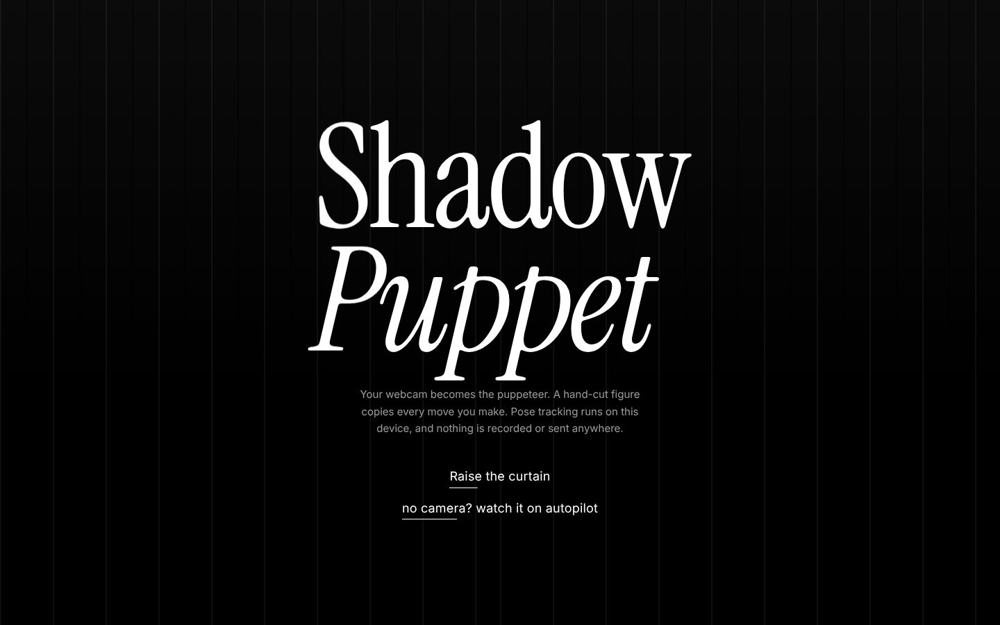

# Shadow Puppet

Webcam pose tracking turns you into a paper-cut shadow puppet. Runs fully in the browser.

**[Live demo](https://shadowpuppett.netlify.app/)** · [Source](https://github.com/Aaryan0604/shadow-puppet) · Built by [Aaryan Gupta](https://github.com/Aaryan0604)

Your webcam becomes the puppeteer. A hand-cut shadow puppet mirrors your body in real time.
Pose tracking (MediaPipe Pose, lite model) runs entirely in your browser. The model and WebAssembly files ship inside
`public/mp/pose/`, so nothing is fetched from a third party, and no video is recorded or uploaded.

## Run
    npm install --ignore-scripts
    npm run dev        # http://localhost:5173  (camera needs localhost or https)
    npm run build      # output in dist/

## Deploy
Every push to `main` builds and publishes to GitHub Pages through `.github/workflows/pages.yml`. In the repo, open Settings, then Pages, and set Source to GitHub Actions (the publish script does this for you).

## How it works
- MediaPipe Pose returns 33 body landmarks per frame. Shoulders, elbows, wrists (and hips/legs when visible) drive the puppet.
- Every joint follows its target through a critically damped spring, so the figure feels weighty, not jittery.
- Webcams rarely see your legs, so they become marionette pendulums reacting to your body's acceleration. If the camera does see them, they are tracked.
- No one in frame: the puppet slumps into a limp rest pose. No camera or permission denied: a scripted "autopilot" performance plays.
- Fast wrist movement leaves fading ink trails. Eyes follow your higher hand. Mouth switches to an "O" when a hand is above the head.

## Stack
React 19, TypeScript, Vite, Tailwind 4, anime.js v4 (curtain timeline, captions, loading dots),
React Bits (BlurText title, Noise paper grain; see src/components/reactbits/LICENSE.md),
Canvas 2D for the puppet, @mediapipe/pose, self-hosted Instrument Serif + Inter.

## Interview talking points (in your own words)
- Why smoothing matters: raw landmarks jitter, so I used critically damped springs instead of a simple moving average.
- Handling missing data gracefully (legs not visible, nobody in frame, camera denied).
- Privacy by design: models bundled, inference on-device, no network calls for video.
- The tradeoff of the legacy MediaPipe Pose package vs the newer Tasks API (bundled, testable offline vs smaller and more modern).

## Licence
MIT for my code. Bundled third-party components keep their own licences.
